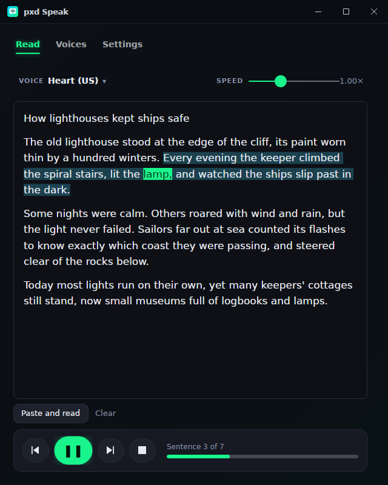
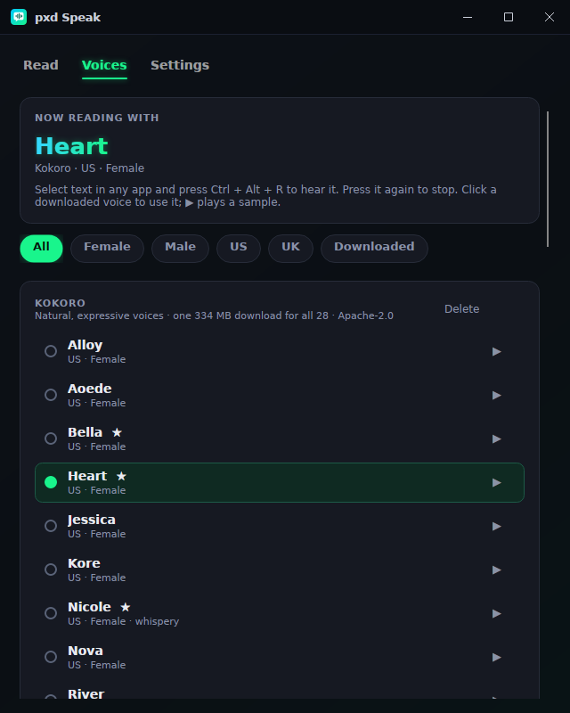
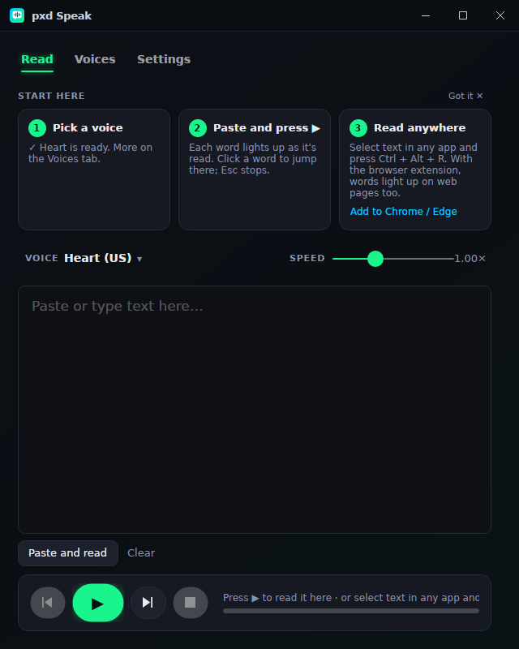
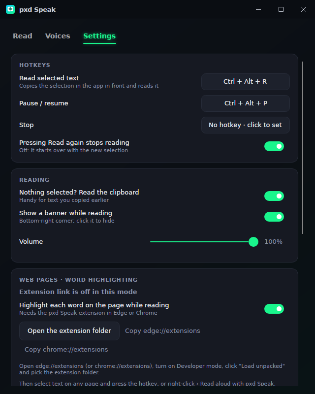

# pxd Speak

Paste text and hear it read aloud in a natural AI voice, with each word lit up as it's heard. Or select text in any app and press **Ctrl + Alt + R**. Free voices, all running offline on your PC: nothing you read is sent anywhere.

<p> </p>

## The Read tab

Paste or type text (or **Paste and read**) and press ▶. While it reads, the sentence is tinted, the word being heard lights up, and the view scrolls along (it holds still for a few seconds when you scroll yourself). Click any word to read from there; **Space** pauses, **Esc** stops and gives you the editable text back. ⏮ / ⏭ skip a sentence. The text is kept between starts.

First start shows three "Start here" cards: download the Kokoro voices (334 MB, one click), paste and press play, and the hotkey plus the browser extension. *Settings › Show the intro* brings them back. The tray's **Open reader with clipboard** opens the Read tab with what you copied and starts reading.

<p> </p>

## Voices

| Family | What | Download | Licence |
|---|---|---|---|
| **Chatterbox** (Turbo, Resemble AI) | the most human-sounding: its built-in voice, the best Kokoro voices re-voiced, or any voice from a 10–20 s clip you add; understands [laugh], [sigh]… | one-time set-up, about 9 GB (private Python + PyTorch + model); needs an NVIDIA graphics card | MIT |
| **Kokoro** (Kokoro-82M v1.0) | 28 natural English voices (US + UK, female + male); best: Heart, Bella, Michael, Fenrir, Emma, George | one 334 MB pack for all | Apache-2.0 |
| **Piper** | 20 hand-picked English voices, light and fast | 64–110 MB per voice | per voice (MODEL_CARD in its folder) |
| **Windows** | voices already installed in Windows | none | Windows |

Voices download from the sherpa-onnx `tts-models` release on GitHub into `%LOCALAPPDATA%\pxdSpeak\Voices`. Kokoro uses the full-precision model: on a desktop CPU it reads about 8× faster than real time (the int8 model was 5× slower).

### How Chatterbox runs

"Set up" in the app uses [uv](https://github.com/astral-sh/uv) (from winget or PATH, else its official release, checked against its SHA-256) to make a private Python 3.11 with PyTorch 2.6 (CUDA 12.4) and `chatterbox-tts` 0.1.7 in `%LOCALAPPDATA%\pxdSpeak\Chatterbox`; nothing is installed system-wide. pxd Speak then starts `server.py` (embedded in the exe) on 127.0.0.1 only; it streams one sentence at a time, quits with the app, and is stopped after a chosen idle time (and when you switch to another voice) so games get the graphics memory back. On an RTX 4090 it loads in about 15 s and makes 14 s of speech in about 3.7 s. Log: `Chatterbox\server.log`.

## Hotkeys and tray

- **Ctrl + Alt + R**: read the selected text (press again to stop). Nothing selected? It reads the clipboard (can be turned off).
- **Ctrl + Alt + P**: pause / resume. A Stop hotkey can be set too.
- The selection is grabbed with a copy; your clipboard is put back right after (and kept out of Win+V history).
- Tray menu: read selection, read clipboard, open the reader with the clipboard, pick voice, speed, settings.

## Word highlighting on web pages

The `BrowserExtension` folder (next to the exe) is a small Manifest V3 extension for Edge and Chrome (`build-extension.sh` packs it for the Chrome Web Store and Edge Add-ons). Until it's listed there, load it once: `edge://extensions` (or `chrome://extensions`) › Developer mode › **Load unpacked** › pick the folder.

Then select text on a page and press the hotkey (or right-click › *Read aloud with pxd Speak*): each word lights up as it's heard, the sentence gets a soft tint, and the page scrolls along (unless you're scrolling yourself). Click a word to jump there; Esc stops. The page is put back exactly as it was afterwards.

- The extension talks only to pxd Speak, over a WebSocket on `127.0.0.1:47321`; the app accepts only browser-extension origins, so web pages can't use it.
- Windows voices report exact word times. Kokoro, Piper and Chatterbox are read a sentence at a time and the words are placed within each sentence by length and pauses (about 0.12 s off on average, measured against a Windows voice's exact times).
- Without the extension (or in other apps) the hotkey still reads the selection, just without highlighting.

## Microsoft Store version

The same app is being prepared for the Microsoft Store (free, with an optional one-time **Pro** add-on that adds new things: save as MP3/WAV, read whole files, audiobooks; every feature here stays free). The Store build differs only where Store rules require it: the Store updates it (no self-update), *Start with Windows* uses the package's StartupTask, Chatterbox is left out (its set-up downloads Python and PyTorch), and "load unpacked" uses a copy of the extension in `Documents\pxd Speak`. Packaging: `packaging/build-msix.ps1`; listing, privacy policy and screenshots: [`docs/store`](docs/store). Privacy policy: [docs/store/privacy.md](docs/store/privacy.md).

## Command line

```
pxdSpeak.exe --read-selection | --read "text" | --stop | --pause     (sent to the running copy)
pxdSpeak.exe --voices                                                  list voices (* = downloaded)
pxdSpeak.exe --download kokoro-multi-lang-v1_0                         download a voice pack
pxdSpeak.exe --wav "text" kokoro:af_heart out.wav [speed]              write speech to a file
pxdSpeak.exe --self-test DIR                                           headless checks, window renders, sample WAVs
pxdSpeak.exe --store-assets DIR                                        MSIX logos, Store screenshots, extension store pictures
```

`PXDSPEAK_DATA_DIR` moves settings and voices (tests).

## Built with

Avalonia 12, .NET 10, [sherpa-onnx](https://github.com/k2-fsa/sherpa-onnx) 1.13.8 (Apache-2.0; 2.x dropped built-in English phonemizing), NAudio, SharpZipLib. Pronunciation by eSpeak NG (GPL-3.0), bundled in sherpa-onnx.
